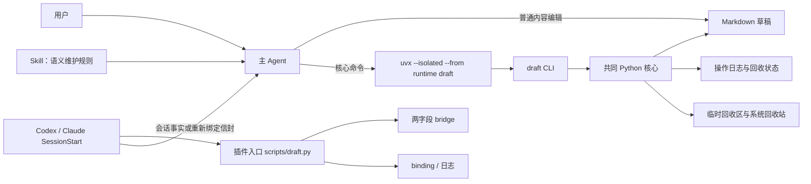

# Draft 正式设计

状态：Draft 领域核心、独立插件、self-contained skill runtime 与插件增强桥接均按当前协议运行；核心命令通过 `uvx --isolated --from` 从当前 skill 的 runtime 包源执行，插件入口（`plugins/draft/scripts/draft.py`）独立承担 bridge/binding/SessionStart，核心不拥有插件状态。插件与 runtime 版本语义独立，`draft` 是唯一活跃产品与协议身份。

宿主机复验仍待执行：真实 Windows 上的单文件 Python 入口（P1 关闭验证）、Codex 校验器、两个宿主的钩子信任与端到端、沙箱 `data_dir` 写权限和宿主官方文档复核。在真实 Windows 复验完成前不得宣称 P1 已关闭。

本文档定义 `draft`（讨论草稿）的产品边界、文档协议、运行架构和交付方式。本文是当前规范性设计；结论汇总和来源草稿仅作为推导资料，两者冲突时以本文为准。

## 1. 摘要

`draft` 用于维护持续时间很长、会反复分叉和递归深入的设计讨论。它把当前上下文之外的重要事实保存为一组可独立阅读的标准 Markdown 页面，使 Agent 和人类能够从索引逐步进入细节，而不必把完整历史重新装回上下文。

第一版由三类能力组成：

1. 一份指导 Agent 进行语义维护的 skill；
2. 一个执行安全文件操作和客观结构检查的 Python 核心与 CLI，通过 `uvx --isolated --from` 从当前 skill 的本地 runtime 包源执行；
3. Codex 和 Claude Code 的轻量 `SessionStart` 钩子；钩子只增强持久环境、会话绑定和压缩后恢复，不改变 Agent 的核心命令入口。插件适配层（`plugins/draft/scripts/`）独立拥有 bridge、binding 和 Hook，不导入或调用 Draft 核心。

Agent 判断讨论意味着什么；程序只处理能够从文件事实证明的事情。正式规范不属于草稿的自动写入范围，只有用户明确批准后，草稿结论才会迁移到正式文档。

## 2. 目标

第一版必须实现以下结果：

- 长讨论可以递归拆分，不让某个子草稿无限膨胀；
- 人类只使用普通 Markdown 和 Obsidian 就能顺畅阅读；
- Agent 能在确认、否定、关键反例和新分支出现时立即维护局部草稿；
- 每个草稿拥有轻量索引和唯一、扁平的 `conclusions.md`；
- 改名、移动和枢纽升降级时自动修复路径链接；回收页面时自动处理父级导航，并拒绝尚未由 Agent 解决的其他入站引用；
- 检查器只报告客观结构问题，不用固定文案约束自然语言；
- 同一 skill 和 Python 核心能够服务 Codex 与 Claude Code；
- 安装环境与用户项目隔离，不共享跨平台虚拟环境；
- 单独复制 `skills/draft/` 后仍能通过 `uvx --isolated --from "<skill_root>/scripts/runtime" draft` 执行核心草稿命令；
- 插件钩子只通过两字段桥接定位宿主持久数据目录，Agent 不读取、推导或搜索宿主数据目录环境变量；
- Python/uv 工具环境是可重建缓存；插件持久状态只在宿主 `data_dir` 创建，不搬迁目录；
- 孵化完成后可以迁移到独立 Git 仓库，而不改变草稿格式或核心行为。

## 3. 非目标

第一版明确不实现：

- 正式设计文档的自动发布或自动改写；
- `PreCompact`（压缩前事件）处理；
- 对话转录的复制、持续镜像或自动语义补漏；
- 每轮 `updated`、`no_change`、`processed_through` 等可靠标记；
- MCP 服务、独立维护 Agent、专用维护会话或后台任务；
- 任务占用、后台接管或完成通知协议；
- 公开计划编号、批准令牌、签名凭证或独立授权服务；
- 永久 `draft_id`；
- 按旧布局名称枚举状态、标签和页面角色的迁移适配器；
- 从系统回收站跨平台检索并自动重新接入页面；
- 回收保留期、重试间隔和最终清理期限的用户配置；
- 依靠 Git 暂存区、提交或回滚完成文件事务；
- 对 skill 文本、标题、章节、摘要或生成结果建立快照测试；
- 让 Agent 调用保存在宿主数据目录中的动态启动器；
- 在普通工具进程中搜索 `PLUGIN_DATA`、`CLAUDE_PLUGIN_DATA` 或宿主默认缓存路径；
- 移动、复制或重命名已创建的虚拟环境；
- 把两字段 bridge 解释成“插件此刻仍启用”的租约或撤销凭证；

这些能力只有在真实使用证明第一版边界不足时才重新评审。

## 4. 孵化与独立交付

### 4.1 Tavern 内孵化环境

Tavern 的 `.claude/skills/` 可提供 skill 试用环境；其项目本地运行状态不进入本仓库，也不属于核心运行依赖。核心代码不依赖 Tavern 的 Python 包、数据库或领域模型。

### 4.2 独立仓库与目标交付形态

当前仓库即独立 marketplace 仓库：

```text
├── .agents/
│   └── plugins/
│       └── marketplace.json
├── .claude-plugin/
│   └── marketplace.json
├── plugins/
│   └── draft/
│       ├── .codex-plugin/
│       │   └── plugin.json
│       ├── .claude-plugin/
│       │   └── plugin.json
│       ├── hooks/
│       │   ├── codex-hooks.json
│       │   └── claude-hooks.json
│       ├── references/
│       │   └── platform-setup.md
│       ├── scripts/
│       │   ├── ruff.toml
│       │   ├── draft.py
│       │   ├── adapter/
│       │   └── tests/
│       └── skills/
│           └── draft/
│               ├── SKILL.md
│               ├── references/
│               └── scripts/
│                   └── runtime/
│                       ├── pyproject.toml
│                       ├── uv.lock
│                       ├── src/
│                       │   └── draft/
│                       └── tests/
└── docs/
```

仓库根目录只承担开发、测试和 marketplace 发布；安装产物是 `plugins/draft/`。`skills/draft/` 本身是可独立分发的完整核心：语义指令、参考资料、runtime 包源和锁定清单都在这个子树内。插件入口（`scripts/draft.py`）和适配层（`scripts/adapter/`）位于插件根，独立承担 bridge、binding 和 SessionStart，不导入 Draft 核心。钩子和插件清单是增强层，不是核心命令的前置条件。

孵化目录到独立仓库的迁移只是重新包装：

- `SKILL.md`、`references/`、`scripts/` 和 runtime 归属同一 `skills/draft/` 子树；
- `hooks/` 位于插件根，只从宿主取得插件根、持久数据目录、会话标识和生命周期事件；
- 不再保留插件根级 `bootstrap/` 或 `runtime/`，也不在数据目录中生成 Agent 命令入口；
- `docs/` 保存规范、设计历史和实现计划，不属于安装后核心运行依赖；
- 草稿格式、CLI 行为和持久状态格式保持不变。

## 5. 权限与责任

### 5.1 用户

用户拥有最终语义确认权，并决定：

- 是否新建、接管或迁移一个草稿；
- 哪些结论已经确认；
- 何时把临时结论迁移到正式规范；
- 何时把孵化项目提取为独立仓库。

### 5.2 Agent

Agent 负责理解讨论，并在事实明确时：

- 更新当前页面；
- 创建或拆分子页面；
- 更新父级导航和正式关系；
- 把已确认且未被取代的结论加入产出页；
- 清除已经解决的正式质疑关系；
- 把旧草稿重写为符合当前协议的候选草稿，并处理不能由程序确定的旧标签、外部结构链接和关系语义；
- 遇到语义歧义、冲突或工具失败时向用户反馈。

Agent 可以直接编辑普通 Markdown 内容。改名、移动、回收、恢复以及其他影响多个文件的结构操作必须通过 CLI。

页面进入 `已确认`、`已关闭` 或 `已取代`，结论迁移到正式文档，以及页面存在时间较长，都不是回收理由。Agent 只有在页面是误建空壳、完整重复页，或错误拆分且全部独有内容已经并回其他页面时，才可以不询问直接执行 `trash`；只要可能丢失独有历史或页面归属不清，就先询问用户。`trash` 本身构成最终删除授权，后续保留窗口不需要人类持续维护。

### 5.3 CLI 与共同核心

CLI 不理解讨论语义，也不是主 Agent 的权限沙箱。它只负责：

- 验证草稿根和路径边界；
- 解析正式 Markdown 结构；
- 生成并执行可恢复的文件变更；
- 修复本地链接；
- 检查客观结构事实；
- 管理权威删除包、恢复窗口、系统回收站尽力移交和已授权的到期清理；
- 保存会话与活动草稿的绑定。

主 Agent 本来就拥有用户授予的工作区能力。第一版不假装 CLI 能阻止主 Agent 绕过它；skill 必须明确要求结构操作使用 CLI。未来若引入权限受限的独立执行者，才使用 MCP 作为共同核心的薄适配层，并撤销该执行者的通用文件能力。

## 6. 总体架构



架构分为五个边界：

1. **Skill：** 保存语义工作流、判断边界和使用时机；
2. **CLI：** 把参数转换为共同核心调用，并输出人类可读结果或结构化 JSON；通过 `uvx --isolated --from` 从当前 skill 的 runtime 包源执行；
3. **共同核心：** 保存全部平台无关的检查和文件操作规则；
4. **插件适配层：** `plugins/draft/scripts/` 中的插件入口和 `adapter/` 包处理 bridge、binding、SessionStart 和宿主变量；不导入或调用 Draft 核心；
5. **草稿：** 保存人类可读的讨论事实，是讨论内容与关系的唯一真相来源。

Codex 与 Claude Code 不得各自实现一份结构规则。宿主差异停在钩子环境变量和清单接线，不进入 binding 或草稿领域模型；适配层不能直接改 Markdown，也不调用核心 CLI。

根内 Markdown 和目录成员/节点类型是链接索引的权威事实。索引只缓存每个覆盖 Markdown 的 SHA-256、出站链接、反向链接表和目录快照；严格扫描每次读取全部覆盖 Markdown 并比较摘要与目录事实，只有路径和摘要均未变化的文件才能复用解析结果。索引不可用或被标记 `rebuild_required` 时，业务操作和链接查询使用当前根的完整链接事实闭包，不把旧索引当作 `fresh`。

## 7. 草稿目录

一个受管理草稿必须是自包含目录：

```text
topic/
├── index.md
├── conclusions.md
├── pages/
│   ├── 01-first-question.md
│   └── 10-nested-topic/
│       ├── index.md
│       └── 10-1-child-question.md
└── .draft/
    ├── draft.json           # 唯一根身份 marker（format_version + root_state + conclusions_state）
    ├── link-index.json       # 存在时为从根内 Markdown 与目录事实派生的链接查询缓存
    ├── link-index-rebuild-required.flag  # 存在时以纯存在性表示需要全根重建
    ├── operation.lock
    ├── operations/
    │   └── <operation-id>/
    │       ├── journal.json
    │       ├── link-index.staged.json
    │       ├── originals/
    │       └── staged/
    └── trash/
        └── outgoing/
```

各部分职责：

- `index.md` 是唯一根索引；
- `conclusions.md` 是唯一、固定、永久扁平的结论汇总；
- `pages/` 保存普通讨论页和递归枢纽；
- 次级枢纽使用完整页面主干名作为目录名，枢纽本身为目录内 `index.md`；
- `.draft/` 是工具内部区域，普通页面不得链接或写入其中；
- `draft.json` 是根身份的唯一权威来源，精确保存 `format_version`、`root_state`（`candidate`/`registered`）与 `conclusions_state`；
- `.draft/link-index.json` 是从根内全部覆盖 Markdown 和目录事实派生的可重建链接查询缓存，不是页面或链接事实的权威来源；`.draft/link-index-rebuild-required.flag` 只以文件存在性阻止未经 journal 判定的旧索引进入 `fresh` 路径，不承载 revision、原因或其他结构化状态；
- `operation.lock` 只在结构操作期间存在，使 Codex 与 Claude Code 即使使用不同平台数据目录也能竞争同一把草稿锁；
- `operations/` 保存未完成结构操作的日志（含根状态与读集观察清单）、恢复副本和暂存内容；链接索引 staging 位于对应 operation 目录下，任何平台都通过草稿根读取同一份恢复事实；
- `trash/outgoing/` 保存仍由插件负责的权威删除包，包括恢复保留期和系统回收站待移交阶段；成功移交或已提交到期清理后才删除其中内容。

链接索引的权威链只有三层：当前 `journal_version=4` operation journal 中合法的链接索引结果、与最新 `published` 结果绑定的 `.draft/link-index.json` 制品，以及对当前根内 Markdown 和目录事实的严格新鲜度证明。journal 记录索引结果和 `link_index_revision`；制品保存派生快照；flag 只提供快速阻断信号，缺失时仍必须读取 journal。

链接索引制品唯一支持 schema `v2`，不保存绝对根路径或 mtime/size 探针：`files` 覆盖 `.draft/` 之外的全部普通 Markdown 并保存 SHA-256 与出站边，`backlinks` 是出站边的精确反向表，`directories` 保存遍历目录的直接成员名称和节点类型。`link_index_revision` 使用规范十进制正整数；`published` 与 `rebuild_required` 都是 journal 的合法权威结果，分别绑定制品摘要或表示旧制品不可用于 fresh。

第一版不保存永久草稿 ID。会话绑定使用显式根路径；目录被移动后，用户重新选择，不由程序猜测。

## 8. Markdown 结构协议

### 8.1 机器区域

每个页面在唯一一级标题之后、正文之前提供一个连续的标准 Markdown 引用块：

```markdown
# D4：记忆图的关系类型

> 状态：`已确认`
>
> 父主题：[根索引](../index.md)
>
> 依赖：[页面模型](02-page-model.md)
>
> 产出：[结论汇总](../conclusions.md)
```

程序只解析这个顶部引用块。正文标题、章节顺序、例子和自然语言不属于机器协议。

允许的标签只有：

- `状态`
- `父主题`
- `依赖`
- `取代`
- `被取代`
- `质疑`
- `被质疑`
- `产出`

`状态` 由机器可识别的状态前缀和可选的人类说明组成。允许的前缀只有：

- `待讨论`：问题已经记录，但尚未形成当前方案；
- `当前提案`：正在评审，尚未确认；
- `已确认`：已经接受，属于当前有效结论；
- `已取代`：已经被另一页面正式取代，只保留历史；
- `已关闭`：讨论已经结束，但没有当前有效结论。

无说明时直接写前缀；需要保留细节时，在前缀后使用全角冒号：

```markdown
> 状态：`已确认`
```

或者：

```markdown
> 状态：`已关闭：历史候选，第一版不采用`
```

检查器先解析 `状态：` 标签，再只解释状态值内部第一个全角冒号之前的前缀；值内冒号后的说明仍是自由文本。引用块中的普通引用句可以存在，但任何形如“标签名：值”的行都必须使用已知标签并满足对应格式。

### 8.2 基本约束

- 每页恰好有一个 `状态`，其前缀必须属于五个已知值；冒号后的可选说明不能为空；
- 除根 `index.md` 外，每页恰好有一个 `父主题`；
- 根 `index.md` 不声明 `父主题`；
- 一个关系标签行只包含一个 Markdown 链接；
- 同一标签可以重复多行表达多个目标；
- 同一标签不能重复指向同一规范化目标；
- 所有结构关系必须指向同一草稿根内的受管理页面；
- 普通正文链接可以指向外部材料；
- 代码围栏中的示例链接不建立结构关系。

### 8.3 关系语义

- **父主题：** 子页声明父页，父页正文必须提供返回子页的可见链接；所有页面形成以根 `index.md` 为唯一根的一棵树。
- **依赖：** 当前页要求先理解目标页；禁止自依赖和任意长度的依赖环。反向“被依赖”由工具查询推导，不落盘。
- **取代：** 新页写 `取代`，旧页写对应 `被取代`；两侧必须成对。带有 `被取代` 的页面必须使用 `已取代` 状态，使用 `已取代` 状态的页面也必须存在至少一个 `被取代`。
- **质疑：** 只表示仍未解决、仍威胁当前方案的反例；质疑页和目标页分别写 `质疑` 与 `被质疑`。问题解决后同时删除两侧正式标签，历史保留在正文或日志中。
- **产出：** 除 `conclusions.md` 自身外，每个 `已确认` 页面必须恰好一次指向根级 `conclusions.md`；其他状态不能声明 `产出`。产出页正文摘要该结论并链接回来源页。反向“来源于”由工具推导。

检查器能证明状态前缀、取代状态和产出来源集合是否自洽，但不能判断 Agent 是否把页面转换成了语义上正确的状态，也不能判断产出摘要是否准确。

状态描述当前页面自身的语义，不汇总其后代状态。只承担链接导航、不表达问题或方案的根索引或枢纽页使用 `已关闭：纯导航页，不表达独立结论`，无论子页仍在讨论还是已经确认；页面自身记录了尚未讨论的问题时使用 `待讨论`，承载当前方案时使用 `当前提案`。不能因为子页已经确认就把导航页机械标为 `已确认`。如果根索引或枢纽页确实提出了一项没有被子页重复表达的独立结论，它可以使用 `已确认`，并和普通来源页一样声明 `产出`。路径角色不构成产出豁免，只有固定产出页 `conclusions.md` 自身例外。

`已确认` 与 `被质疑` 可以同时存在：前者表示结论当前仍被接受，后者表示存在尚未解决、必须向读者显示的挑战。质疑不会自动撤销已经作出的决定；`conclusions.md` 中对应条目必须显式提示该结论仍被质疑。若用户决定质疑已经使原结论不再具有当前效力，Agent 把页面改回 `当前提案` 并移除 `产出`，直到重新确认或关闭。

## 9. 语义维护流程

即时维护是正常路径：

1. 用户确认、否定、提出关键反例或打开新分支；
2. Agent 在当前语义仍然新鲜时更新直接受影响的页面；
3. 若只改普通内容，Agent直接编辑 Markdown；
4. 若发生改名、移动、回收或枢纽升降级，Agent 调用对应 CLI 命令；
5. Agent 更新父级导航、正式关系和 `conclusions.md`；
6. Agent 运行 `draft check` 完整检查；
7. 有客观错误就立即修复，有语义歧义就询问用户。

页面达到约 600 行或 60 KB 时，检查器发出拆分审查提醒。提醒不自动拆页，也不阻止继续讨论。语义已经分叉时，即使页面很短也应拆分。`conclusions.md` 不受容量提醒约束。

正式设计已经吸收某项结论，不会让该结论失效，也不会让它从 `conclusions.md` 消失。为了保持产出页的索引性质，Agent 可以把已经迁移的长条目压缩成一行，至少保留结论本身、草稿来源链接和正式文档链接；这称为紧凑条目，不称为归档，因为它仍属于当前有效结论。结论被正式取代时，才移除旧来源的 `产出` 和对应条目。

## 10. 新建、候选检查、接管与 Agent 主导迁移

程序入口严格分离：

### `draft init ROOT` / `draft init --candidate ROOT`

- `init ROOT` 创建 `root_state=registered` 的全新草稿；`init --candidate ROOT` 创建 `root_state=candidate` 的固定候选根；
- 两者只接受不存在或空目录；
- 两者都耐久发布最小骨架与精确三键 marker；任何失败都不留下看似成功的半初始化根；
- `init` 不使用根定位选择器，`ROOT` 始终显式给出，也忽略 `DRAFT_ROOT`。

### `draft adopt`

- 只接受 `root_state=candidate` 的受管根；未受管目录（无 marker）与已登记根都拒绝；
- 先运行无过滤、无分页的完整候选检查；只有 `errors` 为空才继续；
- 以 `kind="adopt"` 的普通操作日志承载登记事务，marker 的 `candidate→registered` 替换作为唯一受管根 mutation 原子提交；
- marker 是最后一项受管根变更；替换后只核对 after 摘要并完成日志，不再运行会以业务校验失败为由回滚的全根检查；
- 完整候选预检查可以机会式维护链接索引；索引性能降级 warning 不阻止登记，页面 errors、journal/索引制品矛盾、耐久失败或 recovery pending 等内部状态错误阻止登记；
- 恢复按 `OperationKind.ADOPT` 单向收敛：marker 仍是 before 时可在重新证明观察未变后前向完成，marker 已是 after 时只完成提交与清理，绝不回滚根身份；
- 不修改页面，不解释旧格式，也不自动改用其他入口。

### `draft check`

- `candidate` 与 `registered` 共享同一页面、关系、链接、路径与内部状态检查协议；marker 的 `root_state` 决定根前置条件；
- 始终完整扫描；CLI 可以机会式维护链接索引 journal、制品和 flag，但不修改 Markdown、marker，不推进回收生命周期，不执行 recovery；
- 底层纯 checker 可用 `maintain_index=False` 保持只读，这个内部边界不改变 CLI `check` 的维护契约；
- 输出支持 `--code`、`--path-prefix` 过滤、`--limit`/`--offset` 分页与 `--count-only`；过滤和分页只影响诊断呈现，完整扫描结果决定检查结论，机会式索引维护的耐久错误仍按 operation error 返回。

### Agent 主导迁移

第一版不提供 `migrate` 命令，也不提供按来源格式命名的适配器，CLI 也不接受来源路径。迁移按以下工作流完成：

1. Agent 读取只读来源材料和当前草稿协议；
2. `draft init --candidate TARGET` 建立固定候选根；Agent 把内容建立到候选根并重写，来源始终保持不变；
3. Agent 连续调用普通结构命令（`create`/`move`/`promote`/`collapse`/`status set`/`relation add|remove`/`trash`/`restore`/`generate-conclusions`），命令间可直接编辑标题、正文和正文链接；候选命令按操作级门禁执行，不要求整个候选根无错；
4. Agent 自主选择检查点，用 `draft check --code <CODE> --limit N --offset 0` 按诊断类别批量修复；
5. 完整候选检查全绿后执行 `draft adopt`，再以普通 `draft check` 验证已登记草稿。

程序只判断最终候选是否满足当前协议，不识别旧标签，也不替 Agent 决定旧语义。纯链接列表由 Agent 无须询问地逐行展开为每行单目标；旧行含额外语义，或展开后同一标签重复指向同一规范化目标时，由 Agent 结合上下文决定如何保留、合并或重写，无法确定时再询问用户。外部结构链接同样由 Agent 决定是导入页面、改为正文引用、移除关系还是询问用户；候选检查只验证最终结构关系都位于草稿根内。

这种边界把程序限制在确定性事件，把迁移决策交给能够阅读上下文并与用户确认的 Agent。第一版不建立另一套迁移批准状态机。

## 11. CLI 表面

第一版领域 CLI 名称为 `draft`，Agent 始终通过 `uvx --isolated --from "<skill_root>/scripts/runtime" draft` 从当前 skill 的本地 runtime 包源执行。最小命令集合为：

```text
uvx --isolated --from "<skill_root>/scripts/runtime" draft --version
uvx --isolated --from "<skill_root>/scripts/runtime" draft init ROOT
uvx --isolated --from "<skill_root>/scripts/runtime" draft init --candidate ROOT
uvx --isolated --from "<skill_root>/scripts/runtime" draft adopt --root ROOT
uvx --isolated --from "<skill_root>/scripts/runtime" draft check --root ROOT
uvx --isolated --from "<skill_root>/scripts/runtime" draft notify files-changed --root ROOT
uvx --isolated --from "<skill_root>/scripts/runtime" draft move --root ROOT SOURCE TARGET
uvx --isolated --from "<skill_root>/scripts/runtime" draft promote --root ROOT PAGE CHILD [CHILD ...]
uvx --isolated --from "<skill_root>/scripts/runtime" draft collapse --root ROOT HUB
uvx --isolated --from "<skill_root>/scripts/runtime" draft trash --root ROOT PAGE
uvx --isolated --from "<skill_root>/scripts/runtime" draft restore --root ROOT OPERATION_ID
uvx --isolated --from "<skill_root>/scripts/runtime" draft recover --root ROOT
uvx --isolated --from "<skill_root>/scripts/runtime" draft query page --root ROOT PAGE
uvx --isolated --from "<skill_root>/scripts/runtime" draft query links --root ROOT PAGE
uvx --isolated --from "<skill_root>/scripts/runtime" draft query backlinks --root ROOT PAGE
uvx --isolated --from "<skill_root>/scripts/runtime" draft query relations --root ROOT PAGE
uvx --isolated --from "<skill_root>/scripts/runtime" draft query status --root ROOT
uvx --isolated --from "<skill_root>/scripts/runtime" draft query recoverable --root ROOT
```

共同规则：

- 所有读取或修改草稿的命令都要求显式 `ROOT`；
- 不从当前目录向上寻找写入目标；
- `SOURCE`、`TARGET`、`PAGE` 必须是草稿根内的规范相对路径；
- 拒绝绝对路径、`..` 越界、符号链接逃逸和非 Markdown 页面；
- 人类可读输出是默认形式，`--json` 提供稳定的结果类型、错误编号、涉及路径和严重级别；
- 结构写命令附带的生命周期警告在 JSON 中使用结构化对象，至少含稳定 `code`、相关 `operation_id` 和 `details`；本地化句子只用于人类输出，不能充当机器协议；
- 同一结果的人类输出、JSON `ok`、`phase` 和进程退出码必须表达同一事实，不能只在结构化字段中暴露失败却在人类输出中声称成功；
- 结构写命令的 `--dry-run` 使用与真实执行相同的事实和计划边界，但不创建 operation journal、索引 revision、索引制品或 rebuild flag；
- `notify files-changed --root ROOT` 只接受根级外部变更通知，candidate 与 registered 均可用；不接收路径、变更类型、rename map 或 stdin 清单，也不支持 `--dry-run`。成功退出码为 `0`，JSON 固定为 `{"result_type":"files_changed_notification"}`，不返回 revision、warning、变化文件数或消费者状态；已有锁或已分类的索引维护故障仍表示通知送达，参数错误、根选择失败、无效 Draft 根和未预期程序缺陷按真实错误返回；
- 测试断言结构化结果，不断言完整中文诊断句子。

`promote` 把现有叶子 `PAGE.md` 变为 `PAGE/index.md`，并在同一次操作中把至少一个现有受管理 `CHILD` 改挂到新枢纽下。若需要全新子页，Agent 先把它创建为结构合法的同级页，再通过 `promote` 一次完成升格和改挂。命令拒绝生成最终为空的枢纽。

`collapse` 只修复已经为空的非根枢纽；非空枢纽拒绝执行。正常的 `move` 或 `trash` 如果让某个枢纽失去最后一个直接子页，必须在同一操作中自动调用相同的降级原语，不留下空枢纽等待第二条命令。

`trash` 成功后返回 `operation_id`、`restore_expires_at` 和 `purge_eligible_at`，状态为无锁的 `trash_retained`，不立即投递系统回收站。`restore` 只处理指定操作；只有该操作仍为 `trash_retained` 且当前时间严格早于 `restore_expires_at` 时才允许恢复。过期命令可以耐久放弃并清理自己尚未关联的恢复日志，但不得改变原 `T`、权威包、生命周期阶段、移交状态或其他包。

`restore` 的进程退出码和 JSON 语义固定如下：

| 结果 | 退出码 | JSON 信封 |
| --- | ---: | --- |
| 恢复完成 | `0` | `ok=true`、`result_type=restore`、`phase=completed` |
| 引擎已安全回滚恢复 | `3` | `ok=false`、`result_type=restore`、`phase=rolled_back` |
| 已过恢复期限 | `2` | 标准错误信封：`ok=false`、`result_type=error`、`error.code=trash.restore_expired` |
| 可安全回滚的恢复冲突 | `2` | 标准错误信封：`ok=false`、`result_type=error`、`error.code=trash.restore_conflict` |
| 需要恢复或状态不一致 | `3` | 标准操作错误信封，保留现场供 `recover` 解释 |

人类输出必须表达同一事实。特别是 `rolled_back` 不能报告“已恢复”，而要明确页面未恢复、权威包仍保留。

改变根内 Markdown 或索引覆盖目录事实的 operation 在业务结果验证后进入链接索引阶段，并在释放写锁和进入原成功终态前收敛 `published` 或 `rebuild_required`；空操作和只改 `.draft/` 的 operation 不产生 revision。`check`、`query page` 与 `query backlinks` 可以机会式维护全根链接索引；索引不可用时按当前根完整链接事实闭包返回结果。`query links`、relations、status 和 recoverable 不维护全根索引。普通系统回收站投递失败只作为机器可读警告返回，不改变原结构命令的成功状态；权威包损坏、摘要不符、日志关联矛盾或锁状态无法解释时阻止继续写入。

`notify files-changed` 是外部批量编辑稳定后的可选后置通知，不是 fresh 或 recovery 的强制前置，也不是索引错误恢复命令。通知成功只确认根已收到通知，不返回消费者维护结果；通知缺失时，后续允许维护的命令仍严格比较当前根事实。

索引发布失败但已耐久记录 `link_index.rebuild_required` 时保留已验证业务结果，退出码仍为 `0`，并返回 `link_index.rebuild_required` 或 `link_index.rebuild_flag_update_failed` warning；两者均只含机器 `code`/`severity`，旧索引不得进入 `fresh`。journal 结果无法耐久写入时返回 `operation.durability_failed`，退出码为 `3`，保留锁和现场供 recovery 处理。索引性能降级不阻止 candidate `adopt`，但页面 errors、journal/制品不一致、耐久失败和 recovery pending 阻止登记。

`recover ROOT` 只按 journal 证据收敛 recovery pending operation，不推进 retained trash 的到期、系统回收站移交或最终清理。索引阶段按 `link_index_updating → link_index_rebuild_required`、`link_index_published` 验证目标 revision/SHA-256 后补原终态、或 `link_index_rebuild_required` 尽力补 flag 后补原终态前向完成；不分配新 revision，也不因派生缓存故障回滚已验证业务结果。允许的普通受管命令仍可在自身前置阶段推进 retained trash 生命周期。

普通 Agent 不选择宿主平台，也不读取、推导或搜索插件数据目录。Codex 与 Claude Code 只在各自 `SessionStart` 钩子内通过插件入口（`plugins/draft/scripts/draft.py`）读取准确的宿主变量、发布 bridge，并把原始 `session_id` 交给 binding 逻辑；`platform` 不进入核心 CLI 或领域模型。核心命令不读取 bridge、不区分运行模式、不注入 `DRAFT_DATA` 或 `DRAFT_SKILL_PATH`。普通结构命令不需要会话身份。

`setup` 是通过 `draft --version` 触发 uvx 环境准备的工作流，不是其他命令的隐藏前置条件。uvx 从当前 skill 的 runtime 包源构建工具环境；首次执行可能从配置的包索引下载依赖，后续运行复用 uv 缓存。skill 不再依赖插件根的 `bootstrap/` 或数据目录内生成的启动器。

## 12. 安全结构操作

`move`、`promote`、`collapse`、`trash` 和 `restore` 对受管理文件的修改共享同一操作引擎：

改变根内 Markdown 或索引覆盖目录事实的 operation 遵循：

```text
applying
→ validating
→ link_index_updating
→ link_index_published | link_index_rebuild_required
→ 原有成功终态
```

只修改 `.draft/` 或没有实际事实变化的 operation 不进入链接索引阶段，也不产生 revision。

v4 journal 的链接索引字段为 `link_index_revision`、`link_index_result` 和
`link_index_sha256`。`link_index_updating` 只要求 revision；`link_index_published` 要求
result=`published` 与制品 SHA-256；`link_index_rebuild_required` 要求
result=`rebuild_required` 且不带制品 SHA-256。索引阶段前和 rollback 路径不携带这些字段；
解析时区分字段缺失与显式 `null`，不接受其他 journal 版本。

独立维护使用 `kind="link-index.update"`，只记录实际索引维护而不记录触发入口，阶段为
`allocating → link_index_updating → link_index_published | link_index_rebuild_required → completed`。
严格证明无需维护时不创建 maintenance operation；恢复只收敛当前 operation，不分配独立
revision。

1. 验证显式草稿根路径和登记版本。若已经存在 `operation.lock`，普通写命令在读取可能处于中间态的 Markdown 前就拒绝，并提示运行恢复；
2. 生成 `operation_id`，惰性创建并同步固定的 `operations/` 父目录后，以排他方式创建 `.draft/operations/<operation-id>/`，同步其父目录项，再耐久写入初始阶段为 `allocating` 的 `journal.json`；已有同名目录一律报告操作标识冲突并保持其字节不变，绝不能复用或覆盖证据。此时尚未修改受管理 Markdown。`restore` 使用第 13 节规定的预分配关联恢复日志，不重新分配日志或丢弃其关联元数据；
3. 使用排他创建取得草稿内部的 `operation.lock`，锁内容至少记录 `operation_id`；已有锁时普通写命令立即拒绝；
4. 取得锁后再完整检查当前结构、扫描链接图并生成变更计划，把旧内容摘要、恢复副本和全部预期新内容写入同一操作目录；
5. 把日志阶段耐久更新为 `prepared`，再次读取正式文件并核对摘要，拒绝计划生成后的外部修改；
6. 在目标文件所在文件系统准备临时文件，并逐个执行单文件原子替换；
7. 每完成一步就在 `journal.json` 中耐久记录；
8. 运行完整结构检查并验证业务结果；
9. 若 operation 改变根内 Markdown 或索引覆盖目录事实，先耐久写入 `link_index_updating`，再写 operation 专属 link-index staging、原子发布 `.draft/link-index.json` 并耐久记录 `link_index_published`，或在无法完整构建/发布时耐久记录 `link_index_rebuild_required`；发布结果未知时不猜测已发布。索引结果收敛后，普通结构操作进入原有成功终态并释放锁；`trash` 转为无锁的 `trash_retained`，`restore` 按第 13 节完成关联终态。已耐久记录 `rebuild_required` 时保留业务成功并返回 warning。无需继续支持恢复的副本和暂存内容可以清理，权威删除包则按保留协议继续存在。

所有日志读取必须在第一次依据其内容行动前绑定身份：`operation.lock.operation_id`、`.draft/operations/<operation-id>/` 的目录名和 `journal.operation_id` 必须一致。引用另一操作的字段还必须验证目标日志类型、目标标识和反向引用；不能把“字段存在”当作可选增强，也不能用日志自己的内部声明绕过路径身份。任一缺失或错配都报告日志损坏或 `operation.inconsistent_state` 并保留现场。

进程重启时，`recover ROOT` 只读取该草稿的锁和 `.draft/operations/`，不需要平台或会话参数；它只收敛 recovery pending operation，不推进 retained trash 的到期、移交或清理：

- 能证明当前文件仍符合计划前置条件时继续完成；
- 不能继续，但能证明没有外部变化时回滚；
- 无法证明安全或发现人类并发编辑时停止，保留现场并报告冲突。

链接索引阶段使用机械前向规则：`link_index_updating` 进入
`link_index_rebuild_required`，不猜测索引是否已经发布；`link_index_published` 验证目标
revision 与 SHA-256，一致则补原成功终态，不一致则停止并保留现场；
`link_index_rebuild_required` 尽力补建存在性 flag 后补原成功终态。进入
`link_index_updating` 后不回滚业务结果，不分配新的 revision；恢复只清理当前 operation
的 staging 文件，不使用通配符触碰其他 operation 或未知内部文件。

锁不因为“时间过去很久”就自动判为陈旧。锁指向合法操作日志时按日志恢复；锁指向缺失或损坏的日志时报告客观损坏并保留现场，不能擅自解锁。没有锁的 `allocating` 操作目录尚未取得写权限，可以作为未开始操作清理；预分配在初始日志落盘前崩溃遗留的空操作目录同样没有授权，只能作为未关联分配残留清理，不能被后续操作复用。没有锁却声称已经进入 `prepared` 或写入阶段的日志属于矛盾状态，必须停止检查。这样 Codex 和 Claude Code 看到的是同一份可恢复事实，不需要访问对方的平台数据目录。

`check` 对 `candidate` 与 `registered` 使用同一协议并始终完整扫描；CLI 可以机会式维护链接索引，但不修改 Markdown、marker，不推进回收生命周期，也不执行 recovery。底层纯 checker 的 `maintain_index=False` 保持只读。候选写命令按操作级门禁执行，不隐式运行完整检查。`adopt` 以 `kind="adopt"` 的普通操作日志承载登记事务：完整候选预检查可以机会式维护索引，索引性能降级 warning 不阻止登记；页面 errors、journal/制品矛盾、耐久失败或 recovery pending 阻止登记。marker 的 `candidate→registered` 替换作为唯一受管根 mutation 原子提交；marker 是最后一项受管根变更，替换后只核对 after 摘要并完成日志。恢复按 `OperationKind.ADOPT` 单向收敛：marker 仍是 before 时可在重新证明观察未变后前向完成，marker 已是 after 时只完成提交与清理，绝不回滚根身份。因此 `recover` 对任何受管根都按 marker、锁与操作日志判定，不猜测根状态。

工具不覆盖无法解释的新内容，也不以“尽量恢复”为理由猜测合并。

## 13. 页面回收

`trash` 是 Agent 已经完成语义判断后的最终删除授权，不是页面生命周期状态。普通页面永不因确认、关闭、被取代、迁移到正式设计或存在时间较长而自动进入回收。

### 13.1 创建权威删除包

`trash` 流程为：

1. 扫描全部入站引用；
2. CLI 可以在同一事务中自动移除父页面到该子页的导航，因为这是回收必然带来的结构变化；
3. 其他入站引用可能表达依赖、产出、质疑或普通语义，CLI 不猜替代目标，列出这些引用并拒绝执行，直到 Agent 明确移除或改指；
4. 把页面、原路径、内容摘要、相关父文件前后摘要和恢复元数据组成权威删除包；
5. 将权威删除包原子移动到 `.draft/trash/outgoing/<operation-id>/`，同时从受管理树移除页面和父导航；
6. 运行完整结构检查并验证业务结果；
7. `trash` 的页面/目录事实变化按链接索引阶段收敛为 `link_index_published` 或
   `link_index_rebuild_required`，然后持久化带时区的 UTC 时间 `created_at`、
   `restore_expires_at`、`purge_eligible_at` 和 `next_handoff_attempt_at`，把日志转为
   `trash_retained` 并释放写锁。索引降级保留业务结果并返回 warning。

第一版固定 `restore_expires_at = created_at + 7 天`，`purge_eligible_at = restore_expires_at + 30 天`，初始 `next_handoff_attempt_at = restore_expires_at`。这些绝对时间属于该操作的不可变事实；未来默认值变化不能追溯改变已有删除包。`trash_retained` 是合法的无锁状态，页面已经离开受管理树，权威删除包是唯一由插件负责的内容副本。`trash` 不立即调用系统回收站。

权威删除包不能依靠包内字段互相自证。所有清单路径必须在任何 `exists`、读取、摘要或 Markdown 解析之前验证为规范相对路径：页面和父文件必须位于草稿根内，payload 必须位于 `.draft/trash/outgoing/<operation-id>/` 对应包内，绝对路径、`..` 和符号链接逃逸全部拒绝。包目录名、清单 `operation_id` 与 `T.operation_id` 必须一致；`package.json` 字节、payload 路径和 payload 摘要必须与原 `T` 日志中已经耐久记录的 mutation 路径及 `after_sha256` 对应，不能用同一个可变清单中的 `page_sha256` 认证自身。

### 13.2 生命周期

```text
trash
  -> trash_retained
     -> restore（7 天内）
        -> 原 trash 日志 rolled_back
     -> 到期推进
        -> trash_handoff_pending
           -> 系统回收站成功
              -> trash_handoff_succeeded
                 -> completed, disposition=system_trash
           -> 达到最终清理期限，执行最后一次投递
              -> 成功：沿成功路径完成
              -> 明确失败：trash_purge_committed
                 -> completed, disposition=expired_purge
```

恢复窗口使用半开区间：只有 `now < restore_expires_at` 才能开始认领恢复；`now >= restore_expires_at` 即已过期。没有后台计时器，所有期限只在下一次显式或惰性推进时生效，因此实际保留时间可以更长，不能更短。

### 13.3 恢复、竞争与冲突

恢复操作必须按以下顺序建立可构造的不变量：

1. 先耐久创建关联恢复日志 `R`，阶段为 `allocating`，其 `metadata.restores_trash_operation` 必须存在并指向原回收操作 `T`；创建顺序遵守第 12 节的操作目录父项同步规则；
2. 以 `R` 取得草稿写锁，并在锁内重新读取 `T`，确认它仍为 `trash_retained`、当前时间仍在窗口内、权威包及摘要有效且没有其他恢复认领；若写锁已经存在，本次尚未关联的 `R=allocating` 必须同步转为 `rolled_back`、清理分配材料，并返回 `operation.recovery_required`，不得把无法证明存活性的旧锁猜成普通忙碌状态；
3. 把 `R.operation_id` 耐久写入 `T.metadata.restore_operation_id`，形成双向关联；只有这一步完成才算在期限前耐久认领；
4. 使用已经存在的 `R` 生成并执行恢复计划，不能重新分配日志或丢弃反向关联；
5. 保持 `R` 的同一把写锁，只有在 `R` 的完整 mutation 与 `T` 锚定的包证据逐段对应、恢复后文件仍匹配全部 after 摘要且 `R` 已耐久完成后，才能把 `T` 转为 `rolled_back`，清理权威包与恢复材料，最后释放锁。

认领在期限前耐久完成后，即使恢复执行期间越过 `restore_expires_at`，仍允许完成。恢复和到期推进由同一把草稿写锁串行化：若恢复先写入有效认领，恢复获胜；若到期推进先把 `T` 耐久转为 `trash_handoff_pending`，到期推进获胜，后来的恢复返回 `trash.restore_expired`。

正常的并发恢复竞争只发生在排他取得写锁时。若本次 `R` 已取得锁，随后却读到 `T.metadata.restore_operation_id` 指向另一个 `R1`，这不是良性并发：它表示崩溃遗留的恢复现场或关联状态矛盾。本次工具可以放弃并清理自己尚未关联的 `R` 并释放自己的锁，但不得覆盖 `T -> R1`；关联合法且需要继续解释时返回 `operation.recovery_required`，关联缺失或错配时返回 `operation.inconsistent_state`。

下列情况在已经证明 `R` 安全回滚后返回 `trash.restore_conflict`：原路径已经存在、父文件缺失或摘要变化、恢复后结构不合法，或导航无法唯一恢复。冲突时不覆盖、不另选路径、不猜合并，权威包继续由 `T` 保留，原期限继续流逝。权威包、清单、原 `T` mutation、恢复日志或内容摘要互不匹配不是普通恢复冲突，而是 `trash.package_corrupt` 或 `operation.inconsistent_state`；这类证据损坏必须保留现场。

恢复包装层必须用同一终态解决器处理操作引擎的返回和异常。只有 `R=completed` 且第 5 步的完整证据成立时才能提交 `T -> rolled_back` 并清理权威包。引擎返回 `rolled_back`，或引擎在回滚后抛出 `operation.validation_failed` 而耐久状态已经证明 `R=rolled_back` 时，包装层都要在同一锁内执行下面的失败解关联。`operation.external_change` 只有在耐久状态证明恢复已回滚或尚未发生任何受管理变更时才可映射为 `trash.restore_conflict`；无法解释的外部变化、非终态 `R` 或不足的回滚证据必须保留认领、锁和权威包，并把原 `operation.*` 错误交给 `recover`。

`R=rolled_back` 表示恢复没有发生。工具仍在锁内耐久清除 `T.metadata.restore_operation_id`；如果在清除前崩溃，恢复器看到 `T -> R=rolled_back` 后完成同一清除。`R` 日志作为终态审计事实保留，权威包、`T=trash_retained` 和原有绝对期限保持不变，随后才释放锁并向调用者返回回滚结果。

崩溃恢复遵守以下规则：

- `T` 引用 `R` 时，目标目录名、`R.operation_id`、`R.kind=restore` 和 `R.metadata.restores_trash_operation=T.operation_id` 必须同时成立；缺失或错配统一报告 `operation.inconsistent_state`；
- 没有取得锁且没有被 `T` 关联的 `R=allocating` 可以安全放弃并清理其分配材料；
- 取得锁但完整计划尚未耐久形成的 `allocating` 不能前向完成，只能转为 `rolled_back` 并释放锁；
- 处于 `prepared` 及以后阶段的 `R` 才能依据完整变更计划继续或回滚；
- `R=completed` 只有在其完整 mutation 与 `T` 的权威包证据对应且当前文件仍为合法 after 状态时，才能继续完成 `T -> rolled_back` 和权威包清理；证据不足时保留包和锁定现场并大声失败，绝不能再调用系统回收站；
- `R=rolled_back` 不等于原页面已经恢复；清除或解释失败认领后，`T` 按其时间和当前生命周期继续保留或到期推进。

### 13.4 系统回收站移交与最终清理

到达恢复期限后，到期推进先取得写锁并把 `T` 从 `trash_retained` 耐久转为 `trash_handoff_pending`，此后永不再接受 `restore`。每次投递都从权威删除包制作完整一次性副本，只把副本交给系统回收站适配器，权威包在结果耐久落盘前保持不动。

适配器成功返回后，继续持有写锁，先耐久写入 `trash_handoff_succeeded`，再清理权威包和临时副本，最后写入 `completed` 与 `disposition=system_trash` 并释放锁。成功状态写入后崩溃，恢复器只完成清理，不再调用适配器。

投递明确失败时保留权威包，记录机器可读错误，并把 `next_handoff_attempt_at` 固定推进 24 小时后再释放锁。普通惰性推进只有在 `now >= next_handoff_attempt_at` 时重试；达到 `purge_eligible_at` 时不再等待该节流时间，立即进行最后一次投递。第一版不开放重试间隔配置。

外部系统没有幂等键或可查询回执，因此不能承诺恰好一次移交。如果副本已经被接收，而进程在成功状态落盘前崩溃，恢复时仍从未动过的权威包重新制作副本并重试，系统回收站可能出现带有同一 `operation_id` 的重复删除包。实际进程崩溃不会触发永久清理；仍然存活的最后一次调用明确失败后，工具必须先在匹配写锁下耐久写入 `trash_purge_committed`，再删除权威包和临时副本，最后写入 `completed` 与 `disposition=expired_purge`。

`trash_purge_committed` 是永久清理的提交点。提交前发生任何失败或崩溃，页面内容必须仍位于受管理树或有效权威删除包之一；提交后，恢复器只能完成清理，不能恢复、重新投递或重新解释删除授权。`trash_handoff_pending` 缺少权威包属于状态损坏；`trash_purge_committed` 下权威包部分存在或已经缺失属于可继续的清理状态。`trash_handoff_succeeded` 和 `trash_purge_committed` 都必须在完成内部清理前持有匹配写锁。

系统回收站适配优先使用经过目标平台和当前支持 Python 版本验证的成熟库，不自行重写三套桌面协议，也不提供跨平台找回接口。成功移交后的找回交给 Git、操作系统回收站或 Agent 的其他决策。

### 13.5 惰性推进与时钟

到期删除包的推进只由允许的普通受管命令前置执行；`recover ROOT` 只收敛 recovery pending operation，不推进 retained trash 到期、系统回收站移交或最终清理。系统回收站明确失败只产生警告并继续原命令，状态损坏则停止写入。`restore` 只处理指定包，不触发该包或其他包的到期推进。`check` 和 `check --candidate` 可以机会式维护链接索引，但不修改 Markdown、marker 或回收生命周期。

普通受管命令的生命周期前置推进按 `operation_id` 排序，并返回类型化报告。若 `A` 已成功推进而 `B` 因日志或包损坏停止，则 `A` 的结果保持耐久且必须出现在公开信封中，`B` 作为结构化错误和 `stopped_at_operation_id` 返回，`B` 之后的 `C` 不再读取或触碰。结构写命令的前置推进使用 `ok=false`、`result_type=error`、`lifecycle_results=[A...]`、错误对象和停止标识；它保留并报告已有结果，但不得加载当前结构图或开始请求的结构写操作。`recover --json` 只报告 recovery pending operation 的收敛结果，不包含 retained trash 的到期推进结果。退出码按错误编号分类，`operation.inconsistent_state` 等操作错误退出 `3`。普通适配器明确失败已经被转成生命周期警告和结果，不属于批量失败，仍允许原结构命令继续。

第一版使用可注入、带时区的 UTC 墙上时钟。时钟回拨只会推迟推进；时钟前跳可以触发已经持久化的期限。第一版不引入跨重启单调时钟、时钟仲裁、后台任务、批量上限或单独维护服务。

## 14. 检查器

检查器始终完整扫描当前根事实。底层纯 checker 可以使用 `maintain_index=False` 保持只读；CLI `check` 默认允许在完整扫描后机会式维护链接索引 journal、制品和 flag。任何情况下都不修改 Markdown、marker，也不推进回收生命周期或执行 recovery。它输出：

- **客观错误：** 文件事实已经证明结构损坏；结构操作不能把它当作成功；
- **警告：** 结构仍可继续使用，但存在需要 Agent 看到的运行状态，例如系统回收站最近一次投递失败；
- **状态信息：** 合法而尚未结束的生命周期事实，例如权威删除包仍在恢复窗口内；
- **审查提醒：** 值得 Agent 或人类查看，但不自动修改，也不把自然语言判为错误。

第一版至少检查：

- 根目录必需文件和 `format_version`；
- 本地链接、结构链接目标和符号链接逃逸；
- 顶部结构块、已知标签和每行单目标规则；
- 同一标签不能重复指向同一规范化目标；
- 五个状态前缀和可选说明格式；
- 唯一父主题树与父页返回导航；
- 物理枢纽目录和父主题归属；
- 非根空枢纽；
- 依赖自环和依赖环；
- 取代、质疑的双向一致性和取代环；
- `已取代` 与 `被取代` 的双向约束；
- `已确认` 页面的产出完整性、其他状态不得产出、产出目标和产出回链；
- 未完成操作日志是否可以解释；
- 链接索引 journal 的唯一 `v4` 版本、`link_index_revision` 与 `published` 制品的一致性、制品 schema/摘要/反向表完整性，以及当前根事实的新鲜度；索引降级时报告 `link_index.rebuild_required` 或 `link_index.rebuild_flag_update_failed` warning；
- `trash_retained` 的恢复期限、`trash_handoff_pending` 的最近失败，以及回收日志、权威包和锁是否满足第 13 节不变量；
- 普通页约 600 行或 60 KB 的容量提醒。

回收生命周期诊断的严重级别固定为：恢复窗口内的 `trash_retained` 是 `INFO`；已经过 `restore_expires_at` 但尚未被下一次惰性推进处理的 `trash_retained` 仍是合法的 `INFO`；有有效投递失败记录的无锁 `trash_handoff_pending` 是合法但需要注意的 `WARNING`，`now < next_handoff_attempt_at` 时也不能降为信息，到点后只表示已经具备再次推进条件；没有有效失败记录且没有匹配锁的 pending 无法由协议解释，是 `ERROR`。合法状态不必一律降为信息。

`check` 对 `candidate` 与 `registered` 使用同一页面、关系、链接、路径与内部状态协议；marker 的 `root_state` 决定根前置条件，`conclusions_state` 决定结论产物所有权。`check` 始终完整扫描，并可利用扫描结果机会式维护链接索引；它不修改页面或 marker，不推进回收生命周期，不执行 recovery，也不把“有锁”解释为只报告一条错误后停止扫描。底层使用 `maintain_index=False` 时，检查函数只返回事实而不写内部索引状态。检查前后 Markdown、marker 和回收生命周期状态必须相同。

检查器不会把 `已确认 + 被质疑` 本身报告为冲突；它分别验证产出完整性和质疑双向关系。产出页是否清楚提示挑战属于 Agent 与用户的语义评审，不通过固定句子测试。

第一版不检查：

- 标题、摘要、正文、例子或结论的固定措辞；
- 页面是否真的只有一个语义问题；
- 质疑是否成立、取代是否正确、结论是否完整；
- Agent 是否把页面切换成了语义上正确的状态；
- 拼写、文风或外部网页可达性；
- skill 全文和生成文本快照。

检查全绿只表示没有发现机械损坏，不表示讨论语义正确。

链接索引维护入口遵循同一边界：

| 入口 | 内部索引行为 |
| --- | --- |
| `notify files-changed` | 外部批量编辑稳定后的可选维护通知；不接收变化清单，不返回消费者状态 |
| 普通结构写命令 | 业务结果验证后强制收敛索引阶段；只改 `.draft/` 或 no-op 不产生 revision |
| `check` | 完整扫描后机会式维护；不改页面、marker 或回收生命周期 |
| `query page`、`query backlinks` | 为 backlink 事实机会式维护；索引不可用时从完整根事实闭包返回结果 |
| `query links`、relations、status、recoverable | 不维护全根链接索引 |
| `adopt` 完整预检查 | 可先完成独立索引维护；索引性能 warning 不阻止登记，内部状态错误阻止登记 |
| 结构写命令 `--dry-run` | 使用同一事实/计划边界，不写 journal、revision、索引制品或 flag |
| `init` | 不发布首次索引 |
| `recover` | 只收敛已有 recovery pending operation，不推进 retained trash 生命周期 |

从未建立索引或 stale 本身不是公开 warning。索引发布失败但已耐久记录
`rebuild_required` 时，当前业务或查询使用完整事实并返回降级 warning；journal 耐久失败
返回 operation error，退出码为 `3`，并在 `adopt` 中阻止登记。

## 15. 插件上下文、会话绑定与压缩后恢复

本节描述的能力全部属于插件适配层（`plugins/draft/scripts/`），不属于 Draft 核心。核心 CLI 不读取 bridge、不区分运行模式、不拥有 binding 或 SessionStart。插件适配层只依赖 Python 标准库，不导入或调用 Draft 核心。详细操作命令和故障恢复见 [`plugins/draft/references/platform-setup.md`](../plugins/draft/references/platform-setup.md)。

### 15.1 两字段桥接

插件钩子能从宿主获得准确的持久数据目录：Codex 使用 `PLUGIN_DATA`，Claude Code 使用 `CLAUDE_PLUGIN_DATA`。普通 Agent 工具进程不可依赖这些钩子环境变量，因此 `SessionStart` 向当前用户安全运行目录发布最小 bridge（桥接定位器）。

```text
installation_key = sha256(UTF-8(realpath(plugins/draft/scripts/draft.py)))
bridge_path = <safe-runtime-dir>/draft/bridges/<installation_key>.json
conflict_path = <safe-runtime-dir>/draft/bridges/<installation_key>.conflict
bridge_lock_path = <safe-runtime-dir>/draft/bridges/<installation_key>.lock
```

`<safe-runtime-dir>` 是钩子和普通插件命令都能确定的当前用户安全运行目录。POSIX 优先使用所有权和权限合法（`0o700`、当前用户拥有）的 `XDG_RUNTIME_DIR`，否则在系统临时目录下创建当前用户独占子目录；Windows 使用当前用户临时目录。`installation_key` 只是由插件入口规范路径派生的安装实例文件名，不是内容摘要或安全凭证。

bridge JSON 严格只有两个字段：

```json
{
  "schema_version": 1,
  "data_dir": "/absolute/plugin/data/path"
}
```

未知字段、未知版本、非绝对目录、损坏 JSON、不安全符号链接、非普通文件或所有权异常均报告 `plugin.context_invalid`，退出 4。bridge 不保存 `platform`、`runtime_version`、`entry_path`、`entry_digest`、`session_id` 或环境路径。

发布和消费在同一 `bridge_lock_path` 上取得操作系统级排他锁，并使用同目录临时文件、刷新到磁盘和原子替换发布 JSON。同一 `installation_key` 收到不同 `data_dir` 时原子创建不含路径信息的冲突哨兵，报告 `plugin.context_conflict`，并使后续普通插件命令停止使用冲突前的旧 JSON。用户先停止重复加载，再执行 `uv run <plugin_entry> plugin-context reset`；该维护动作在同一锁内删除本安装键的 JSON 和哨兵，不接受 `data_dir`。

bridge 的必要文件与锁操作发生 `OSError` 时，一律在知道具体操作对象与路径的函数现场转换为 `plugin.context_invalid`（退出 4），保留异常链，不泄漏原始 traceback。锁内主错误在途时，解锁/关闭等清理失败以稳定明细码 `cleanup.unlock_failed`、`cleanup.close_failed`、`cleanup.unlink_failed` 追加到主错误 `details`（顺序与执行顺序一致，普通文本与 JSON 均可见），绝不覆盖主错误；Hook 只显示净化后的诊断码；无主错误时清理失败本身必须明确失败。持久 JSON 文件的无效 UTF-8 按损坏处理（`load_context` 报 `plugin.context_invalid`、`load_binding` 报 `binding.invalid`、`publish_context` 原子重写）；含孤立代理码位的 `data_dir`、binding 字段或插件入口路径按对应持久载荷或上下文无效处理。目录 fsync 明确规定为尽力而为；其余文件写入、文件 fsync、替换、删除和锁操作均为强制步骤。

bridge 是数据目录定位器，不是租约。插件禁用或钩子未信任时不再发布或恢复绑定，但已存在且仍合法的 bridge 可继续被当前进程消费。若未来要求禁用后立即撤销，必须单独设计租约协议，不得向当前两字段 JSON 暗中添加语义。

### 15.2 bridge 状态

bridge 状态严格区分，不得把 `missing`、`invalid` 或 `conflict` 降级到全局 Draft 目录：

| 状态 | 含义 | 普通插件命令行为 |
| --- | --- | --- |
| `missing` | 本安装尚未由 Hook 发布上下文，或临时目录被清理 | `plugin.context_unavailable`，退出 4 |
| `valid` | 唯一、安全的宿主 `data_dir` 已发布 | 继续执行 bind/unbind |
| `invalid` | JSON、字段、路径、权限或文件类型无效 | `plugin.context_invalid`，退出 4 |
| `conflict` | 同一安装键观察到不同宿主数据目录 | `plugin.context_conflict`，退出 4 |

核心命令不读取 bridge，不区分"独立模式"和"插件增强模式"。核心 runtime 的工具环境由 uv 的 `uvx --isolated --from` 构建，位于 uv 自己的平台缓存目录，属于可丢弃、可自动重建的 uv 缓存；Draft 不选择环境路径、不创建 `envs/<runtime_version>`，也不定义 `runtime.cache_unavailable`。

### 15.3 会话绑定

绑定只存在于宿主 `data_dir/bindings/`，不写入草稿 Markdown，也不成为草稿身份。`platform` 不进入插件 CLI、JSON 或路径：宿主已经用各自 `data_dir` 隔离安装状态，平台名不改变绑定语义。

宿主提供的原始 `session_id` 是唯一逻辑身份。适配层把它视为不透明字符串，不验证唯一性，不执行 Unicode 规范化，也不增加长度、字符集或外形限制：

```text
binding_key = sha256(UTF-8(session_id))
binding_path = data_dir/bindings/<binding_key>.json
```

SHA-256 只用来产生定长、路径安全的物理文件名。绑定 JSON 严格只有三个字段：

```json
{
  "session_id": "original-host-session-id",
  "root": "/absolute/draft/root",
  "last_page_hint": null
}
```

读取时必须验证 payload 中的 `session_id` 与本次请求完全相同；错配时报告 `binding.session_mismatch`，不返回其中 root。不再保存 `skill_name` 或 `skill_digest`；skill 内容变化不改变会话与目录的关联，重新执行 bind 也不能证明 Agent 已阅读新指令。

Agent 使用插件入口（SessionStart 信封提供的 `<plugin_entry>` 规范绝对路径）执行：

```text
uv run <plugin_entry> bind ROOT --session SESSION_ID [--last-page-hint PAGE]
uv run <plugin_entry> unbind --session SESSION_ID
```

`last_page_hint` 只是建立绑定时记录的导航提示，不是阅读游标。重新绑定时 Agent 先以根索引和当前对话为准；提示页存在且仍符合话题时才优先打开。

### 15.4 SessionStart

Codex 与 Claude Code 的插件清单都声明实际存在的 `SessionStart` 钩子，并从插件根以同一命令形状直接调用插件入口：

```text
uv run "${PLUGIN_ROOT}/scripts/draft.py" hook session-start codex
uv run "${CLAUDE_PLUGIN_ROOT}/scripts/draft.py" hook session-start claude
```

Codex 适配器只读取 `PLUGIN_ROOT`、`PLUGIN_DATA` 和 hook stdin；Claude 适配器只读取 `CLAUDE_PLUGIN_ROOT`、`CLAUDE_PLUGIN_DATA` 和 hook stdin。Codex 提供的 Claude 兼容别名不参与选择。当前公开边界见 [Codex Hooks](https://learn.chatgpt.com/docs/hooks) 和 [Claude Code Hooks](https://code.claude.com/docs/en/hooks)；实现适配层前必须再次复核官方字段和输出格式。

每次 `SessionStart` 按八步顺序执行：

1. 根据 `HOST` 只读取对应宿主的 root/data 变量；不混用两个宿主的变量；
2. 验证插件根、入口和 `skills/draft/SKILL.md` 均位于预期布局；
3. 发布或验证 bridge；
4. 最多读取 65,536 字节标准输入（按字节而非字符计长，超限检查先于 UTF-8 解码），严格 UTF-8 解码并解析验证 `SessionStart` 载荷；
5. 提取原始 `session_id` 和启动 `source`；
6. 从宿主 `data_dir` 加载 binding；
7. 记录尽力而为的宿主 Hook 日志；
8. 输出会话事实、重新绑定信封或诊断。

无绑定时只注入当前 `session_id` 的短事实，不伪造活动草稿或动态启动命令。有绑定时校验会话 ID、草稿根和页面提示，再注入短重新绑定信封。信封包含活动草稿根、可选页面提示、当前 skill 规范路径、插件入口、宿主提供的触发原因，以及要求 Agent 重新读取完整 skill 的指令。它不复制 skill、转录或草稿内容，也不创建维护任务。Codex 的启动来源为 `startup`、`resume`、`clear`、`compact`；Claude Code 还可提供 `fork`。触发原因只作为宿主事实显示，不改变绑定身份。

Hook 的协议错误不得阻止宿主会话启动：脚本可执行时，`hook session-start` 对载荷、bridge、binding、布局和日志错误都输出或记录诊断并返回 0。`uv` 无法启动脚本属于宿主执行层失败，不在脚本能够转换的范围内。普通核心命令只有在 `draft` 控制台命令启动后才进入 Draft 的错误协议；`uvx` 自身的 Python 发现、包索引访问、依赖解析、构建或缓存错误直接保留 uv 的标准错误输出和退出码。

真正的新会话没有旧绑定。skill 可展示候选草稿，但只能在用户明确选择后执行 `bind`；即使只有一个候选也不静默绑定。核心命令不依赖 SessionStart；不猜测数据目录，也不要求重启才能使用核心命令。

## 16. 核心运行环境与版本关系

### 16.1 核心命令入口

Agent 从已加载 skill 取得 `<skill_root>`，执行：

```text
uvx --isolated --from "<skill_root>/scripts/runtime" draft <core-command> ...
```

`setup` 工作流执行 `uvx --isolated --from "<skill_root>/scripts/runtime" draft --version`。`--isolated` 只保证忽略通过 `uv tool install` 安装的同名工具，仍复用 uv 的工具环境缓存；不得增加 `--no-cache`。不使用 `--no-env-file`，uv 的用户级配置和已有进程环境按 uv 标准语义生效。

独立运行和插件安装后的普通 Draft 操作使用同一本地包源和同一命令。命令不依赖当前工作目录中的项目环境，也不从包索引查找名为 `draft` 的发行包。Python 领域核心不扫描插件根、父目录、宿主缓存或默认数据目录。

### 16.2 Python 与依赖范围

运行核心的 Python 兼容范围由 `pyproject.toml` 的 `requires-python` 声明，具体解释器由 uv 按约束选择。不为没有真实需求的旧 Python 建立兼容矩阵。

核心 runtime 的直接运行依赖使用基于当前已验证版本的补丁窗口：

```toml
dependencies = [
    "markdown-it-py>=4.2,<4.3",
    "Send2Trash>=2.1,<2.2",
]
```

本地源码首次构建还会解析构建后端，因此 `[build-system].requires` 同样使用有界补丁窗口：

```toml
requires = ["hatchling>=1.31,<1.32"]
```

直接依赖的新补丁版本可以在范围内被首次解析采用；新次版本必须先通过兼容性门禁，再显式扩展范围。Draft 不直接约束未直接使用的传递依赖；其可接受范围由直接依赖的包元数据决定。

核心 runtime 的工具环境由 uv 的 `uvx --isolated --from` 构建，位于 uv 自己的平台缓存目录，属于可丢弃、可自动重建的 uv 缓存；Draft 不选择环境路径、不创建 `envs/<runtime_version>`，也不定义 `runtime.cache_unavailable` 或 `runtime.environment_invalid`。不同来源、解析结果和 Python 版本的环境隔离由 uv 的工具缓存语义负责。

### 16.3 uv.lock 的角色

`runtime/uv.lock` 保留，但只用于仓库开发、测试和静态门禁的可重复环境。最终用户的 `uvx` 命令不读取该锁文件，锁文件内容也不是最终用户执行协议。首次执行可能从配置的包索引下载第三方运行依赖和构建依赖；缓存命中后复用已有工具环境。该设计不承诺无网络首次执行，但不得联网取得 Draft 自身源码。

### 16.4 版本关系

插件版本与核心 runtime 版本不再要求数值相同：

- 插件 manifest 版本描述整个安装包；适配层或内嵌核心任何发布级变化都必须提升插件版本；
- Codex 与 Claude 的 plugin manifest 必须声明相同插件版本；
- runtime `project.version` 只描述 Draft 核心可执行实现；runtime 源码、直接依赖范围、构建依赖范围或控制台入口发生发布级变化时必须提升 runtime 版本；
- 只修改适配层时，runtime 版本保持不变；
- 相同 runtime 版本的源码和依赖范围必须不可变，使 uv 的本地包缓存身份与发布语义一致；
- 只更新开发依赖或 `uv.lock` 中不影响最终用户解析的条目时，不要求提升 runtime 版本。

本次发布插件与 runtime 版本均为 `0.3.0`，但二者版本语义此后独立。由于适配层不调用核心 API，不需要运行时兼容握手。远程 marketplace 始终安装同一插件提交中的适配层与核心普通文件。

### 16.5 插件持久数据布局

```text
data_dir/
├── bindings/
│   └── <binding_key>.json
└── logs/
```

插件持久状态（binding、日志）只写入宿主 `data_dir`，不写入 uv 缓存。bridge 位于当前用户安全运行目录，不位于 `data_dir`。插件从最后一个安装范围卸载时，宿主默认删除整个 `data_dir`；用户显式选择保留数据时保留。

## 17. 错误与并发边界

- 单写者锁只协调本工具的结构操作，不能阻止 Obsidian 或编辑器写文件；内容摘要负责发现外部并发修改。
- 内部日志、权威包和关联字段同样属于不可信的持久化输入；读取后必须验证路径身份、版本、类型、必填字段和跨文件证据，不能以“它由本工具写入”为由跳过收口。
- 客观结构错误使结构操作失败；审查提醒不会单独阻止普通讨论。
- 未知或更高 `format_version` 要求升级工具；未来已知旧版本要求显式格式迁移。未登记的旧内容由 Agent 重写为当前候选格式，不能根据缺失版本猜测它属于某个来源适配器。
- Markdown 结构和 `draft.json` 使用 `format_version=1`；操作日志唯一支持 `journal_version=4`。程序不双读、不迁移、不填补其他版本默认值；遇到旧、未知或更高版本时返回 `operation.journal_version_unsupported` 并停止写入。
- 程序不从文件时间或旧阶段猜测 `created_at`、`restore_expires_at` 或 `purge_eligible_at`；v4 journal 的 phase、链接索引字段和关联证据必须满足当前状态模型，否则返回 `operation.journal_corrupt` 或 `operation.inconsistent_state`。
- 本地链接解析忽略代码围栏示例，但不靠全文文本替换修复路径。
- 结构操作日志、恢复副本和暂存材料位于草稿根的 `.draft/operations/`，不调用 Git 命令；插件 `data_dir` 只保存会话绑定和诊断日志。
- bridge 不存在时 bind/unbind 报告 `plugin.context_unavailable`；bridge 存在但损坏、不安全或冲突时是不同状态，必须保留可诊断证据并停止。
- bridge 锁只保护定位器状态的发布、消费和 reset，不覆盖后续 Draft 命令；uv 工具环境并发由 uv 自身协调。
- 生命周期钩子失效或未信任时，核心命令仍可通过 `uvx --isolated --from` 执行；已有合法 bridge 时仍可显式 bind，无 bridge 时 bind/unbind 报告 `plugin.context_unavailable`。第一版不建立第二份转录备份。
- `data_dir` 不可用时，插件命令、会话绑定和生命周期入口拒绝读写；草稿内部恢复证据仍只位于草稿根，不依赖数据目录。
- uvx 启动失败（Python 发现、包索引访问、依赖解析、构建或缓存错误）直接保留 uv 的标准错误输出和退出码；外层没有启动器将其转换为 Draft 错误码。

## 18. 验证策略

### 18.1 程序验证

Python 代码使用：

```bash
uv run --project plugins/draft/skills/draft/scripts/runtime --locked pytest
uv run --project plugins/draft/skills/draft/scripts/runtime --locked pyright
uv run --project plugins/draft/skills/draft/scripts/runtime --locked ruff check plugins/draft/skills/draft/scripts/runtime
uv run --project plugins/draft/skills/draft/scripts/runtime --locked ruff check plugins/draft/scripts
uv run --project plugins/draft/skills/draft/scripts/runtime --locked ruff format --check plugins/draft/skills/draft/scripts/runtime
uv run --project plugins/draft/skills/draft/scripts/runtime --locked ruff format --check plugins/draft/scripts
```

`pyright` 从第一版启用 strict。测试使用小型人工目录验证真实行为，包括：

- 合法与非法顶部结构块；
- 五个状态前缀、值内冒号解析、可选说明、状态与产出完整性；
- 普通检查与候选检查的登记边界，最终登记根的 `candidate.already_registered`、临时登记态的 `adopt.recovery_required`，以及候选检查可写内部链接索引但始终不改页面、marker 或回收生命周期；
- 候选检查通过后的完整文件集合或摘要发生结构合法变化时，`adopt` 撤销自己的临时标记并保留并发编辑；临时标记写入后崩溃时，普通命令拒绝使用，再次 `adopt` 能按原清单确定完成或撤销；
- 断链、路径逃逸、父子不一致、依赖环、产出冲突和同标签重复规范化目标；
- 纯导航根页或枢纽使用 `已确认` 时同样要求产出，`已确认 + 被质疑` 不被误判为冲突；
- 改名后的入站与出站链接修复；
- 枢纽升格、显式空枢纽降级和最后子页离开时的自动降级；
- 操作中途崩溃后的继续、回滚和冲突停止；
- 一个模拟宿主留下操作锁和日志后，另一个模拟宿主只凭同一 `ROOT` 完成恢复；锁与日志不一致时保护现场；
- `trash_retained` 在 7 天内可恢复、边界时刻拒绝恢复，以及 37 天最终清理期限；
- 恢复和到期推进的锁竞争、第二个恢复在取得锁失败时同步放弃自己的未关联日志、取得锁后发现旧认领时不把它误判为良性竞争、期限前耐久认领、恢复冲突，以及关联日志创建、双向关联、页面落盘和终态转换之间的崩溃窗口；
- 锁标识、操作目录名与日志 `operation_id` 错配，缺失反向关联，以及没有匹配恢复 mutation 的伪 `R=completed` 均保留权威包并大声失败；
- 操作标识碰撞或预存同名目录时排他预分配失败且原目录字节不变；无锁空分配残留与非空损坏目录按不同规则处理；
- 权威包绝对路径、`..`、符号链接逃逸、包外 payload、自报摘要和与原 `T` mutation 不一致时均在任何包外读取或清理前失败；
- `restore` 返回 `rolled_back`，以及操作引擎回滚后抛出可分类异常时，页面缺失、权威包和原期限保留、失败认领和锁被同步解决；安全回滚结果退出 `3`，过期与恢复冲突退出 `2`，未知中间态保留现场并退出 `3`；JSON 与人类输出都不得报告恢复成功；
- 权威包或证据摘要不匹配报告完整性损坏而非 `trash.restore_conflict`，且不能清理唯一权威包；
- 系统回收站成功、明确失败、调用期间崩溃、可能重复投递、24 小时节流，以及普通投递失败不阻塞原结构命令；
- `trash_handoff_succeeded` 与 `trash_purge_committed` 写入前后崩溃、部分清理、权威包缺失和锁不一致；
- 时钟回拨、前跳、惰性推进和 `check` 不推进生命周期；恢复窗口内与到期未推进的 retained 为信息，节流期内有失败记录的 pending 为警告，无失败记录且无锁的 pending 为错误；
- 批量推进中前项成功、当前项损坏时公开返回前项结果和停止位置，后续项保持完全未触碰；同一失败发生在结构写前置推进时，请求的结构写不开始；
- 当前、未知和非法 `format_version` 与 `journal_version`，以及候选检查与临时态复核都通过后 `adopt` 才发布最终 `draft.json`；
- `journal_version=4` 的链接索引 phase/字段矩阵、`published`/`rebuild_required` authority、revision/SHA-256/flag 一致性、完整 Markdown 摘要新鲜度和目录节点快照；
- notification 的固定 `files_changed_notification` 信封、candidate/registered 根、无路径清单、已有锁吸收和非预期异常边界；`check`、`query page`、`query backlinks` 的机会式维护及完整事实回退；`query links`、无关 query、dry-run 和 init 不写索引，以及 recover 只收敛已有 pending operation、不触发独立索引维护或新 revision；
- 索引发布/flag 降级 warning 保留业务成功、journal durability failure 退出 `3` 并保留现场、adopt 对 warning 与内部状态错误的不同分类；
- `link_index_updating`、`link_index_published` 和 `link_index_rebuild_required` 各恢复窗口，以及 recover 不推进 retained trash 生命周期；
- `platform` 从插件 CLI、模型、JSON 和路径中完全删除，文件名为原始 `session_id` 的 SHA-256，payload 错配时拒绝返回 root；binding 不再保存 `skill_name` 或 `skill_digest`；
- bridge 不存在、合法、损坏、不安全、冲突和 reset 后状态，以及同一安装键的并发发布；
- Codex 和 Claude Code 的 `SessionStart` 清单、宿主变量选择、无绑定会话事实、已绑定信封与重复调用幂等性；
- 单独复制 `skills/draft/` 后通过 `uvx --isolated --from` 执行 version、init 和 check；
- 把 `plugins/draft/` 复制到无 `.git`、无仓库父目录的临时位置后，执行完整插件分发 smoke test：Hook 发布 bridge、bind/unbind、核心 uvx 命令、状态隔离断言；
- CLI 人类输出和结构化结果的语义一致。

测试断言行为、错误编号、路径和严重级别，不断言完整中文句子。

### 18.2 Skill 验证

不为 `SKILL.md` 建立固定文本测试、标题测试或生成内容快照。skill 通过以下方式评审：

- 人工阅读其职责边界是否清楚；
- 在真实长讨论中试用；
- 让 Agent 把真实旧草稿迁移到空候选根，观察它能否处理表外旧标签、外部结构链接和一行多目标关系，并在必要时询问用户；
- 观察是否及时维护、是否错误拆分、是否漏掉确认或质疑；
- 根据真实失败更新 skill 和工具。

机械问题应进入 CLI 或检查器，不能用更多提示词替代可以确定执行的程序。

## 19. 交付验收条件

当前交付满足以下条件：

- 用户批准本文档和后续实现计划；
- Claude Code 能从 Tavern 的 `.claude/skills/` 发现并使用 skill；
- `init`、`check --candidate` 和 `adopt` 严格区分空根、未登记候选、临时登记态和最终登记草稿，并拒绝越界输入；最终登记根的候选检查稳定返回 `candidate.already_registered`，临时态返回 `adopt.recovery_required`；检查可以维护内部链接索引但不改页面、marker 或回收生命周期，`adopt` 的临时态可确定恢复，不能因崩溃伪装成已接管；
- Agent 能把至少一个真实旧草稿迁移到新的空候选根，来源零改动，程序不包含来源格式适配器；
- 检查器覆盖已确认的客观结构规则；
- `move`、`promote`、`collapse`、`trash`、`restore` 和 `recover` 能在故障注入下保护数据；
- 在 `trash_purge_committed` 之前，任何失败或崩溃后页面内容仍位于受管理树或有效权威删除包之一；提交之后只能完成已经授权的清理；
- 日志身份、权威包、恢复计划和恢复后文件形成从 `T` 到最终文件的完整可验证证据链，任何自报、缺失或错配状态都不能触发唯一权威包清理；
- 恢复引擎的返回与异常通过同一终态解决器收口；安全回滚会同步解关联并保留包，无法证明的中间态保留锁和现场，普通冲突与证据损坏使用不同错误语义；
- 7 天恢复、随后 30 天尽力投递、24 小时节流和最终清理的时间边界可通过注入时钟确定验证，普通历史页面永不按年龄自动回收；
- 批量生命周期推进的部分成功结果不会被后续损坏项的错误信封吞掉，损坏项之后的包不被触碰，结构写前置推进失败时结构写本身不开始；
- `check` 与 `check --candidate` 在成功、警告和错误情况下都完整扫描，允许维护内部索引，但保持 Markdown、marker 和回收生命周期不变；底层 `maintain_index=False` 纯 checker 保持只读；
- Tavern 项目级 Claude 钩子接线完成后，压缩或恢复能重新绑定 skill，同一事件重复执行无副作用；
- 新会话不会自动猜测草稿；
- Python 门禁全绿；
- 至少用一个真实 Tavern 草稿完成人工试用；
- 安装产物不依赖 Tavern 项目代码。

自包含 skill runtime 与插件增强边界还满足：

- runtime 完整位于 `skills/draft/scripts/runtime/`，插件根不再存在 `runtime/` 或 `bootstrap/`；核心外层 launcher（`skills/draft/scripts/draft.py`）已删除；
- Agent 核心命令只使用 `uvx --isolated --from "<skill_root>/scripts/runtime" draft`，Windows 与 POSIX 同一命令；插件命令使用 `uv run <plugin_entry>`；
- bridge JSON 严格只有 `schema_version` 和 `data_dir`，不存在与损坏产生不同结果，竞争的数据目录稳定进入冲突哨兵状态；
- 插件适配层只依赖 Python 标准库，不导入或调用 Draft 核心；插件钩子首次运行可以发布 bridge，不依赖旧 setup 或数据目录启动器；
- 核心 runtime 的工具环境由 uv 的 `uvx --isolated --from` 构建，位于 uv 自己的平台缓存目录；Draft 不创建 `envs/<runtime_version>`，不定义 `runtime.cache_unavailable` 或 `runtime.environment_invalid`；
- 绑定严格三字段（`session_id`、`root`、`last_page_hint`），不再包含 `platform`、`skill_name` 或 `skill_digest`；会话标识按宿主原值哈希并在 payload 中精确复核；
- Codex 与 Claude Code 的受信任 `SessionStart` 都按八步顺序执行，有合法绑定时恢复活动草稿；
- 插件 manifest 版本与 runtime 版本具有独立语义，当前版本均为 `0.3.0`；
- 清单校验、完整 Python 门禁、复制后 skill 烟雾测试和完整无仓库父目录分发 smoke test 全部通过。

## 20. 规范参考

1. 插件清单、完整改名与路径契约由 `docs/superpowers/specs/2026-07-30-draft-plugin-manifests-and-path-contract-design.md` 定义；
2. 自包含 skill runtime、两字段 bridge、无平台绑定与双宿主 `SessionStart` 的边界由 `docs/superpowers/specs/2026-07-30-draft-self-contained-skill-runtime-design.md` 定义，并以 `docs/superpowers/plans/2026-07-31-draft-self-contained-skill-runtime.md` 为实施参考；
3. 单文件 Python 启动入口、版本环境键和非可编辑 runtime 安装由 `docs/superpowers/specs/2026-08-04-draft-single-python-launcher-design.md` 定义；真实 Windows 宿主复验仍是 P1 验收条件；
4. 核心与插件适配层同仓库拆分的边界由 `docs/superpowers/specs/2026-08-05-draft-core-plugin-separation-design.md` 定义：核心命令通过 `uvx --isolated --from` 从当前 skill 的 runtime 包源执行，插件入口独立承担 bridge/binding/SessionStart，核心不拥有插件状态，插件与 runtime 版本语义独立；
5. `docs/discussion/` 保存推导资料，与本文冲突时以本文和当前规格为准；
6. 租约撤销、环境回收、转录备份等不在当前能力边界内，只有真实使用证明边界不足时才重新评审。
